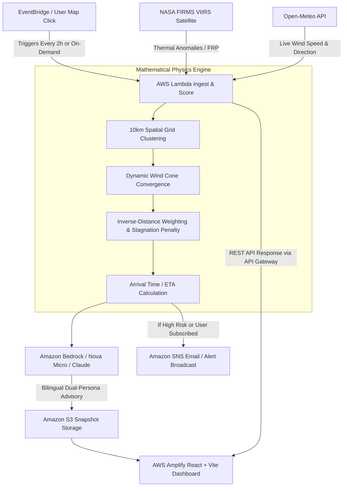

# 🎬 StubbleWatch — Demo Video Master Guide & Complete Context

> **Project Name:** StubbleWatch (TrioBuilds)  
> **Track:** AWS Hackathon — Clean Air & Environmental Intelligence  
> **Live Web App:** [https://main.d2rshd6w3xwz8n.amplifyapp.com](https://main.d2rshd6w3xwz8n.amplifyapp.com)  
> **Production API:** `https://j80bcy6nwf.execute-api.ap-southeast-2.amazonaws.com/Prod/score`  
> **GitHub Repository:** [https://github.com/damnRITIJ/TrioBuilds](https://github.com/damnRITIJ/TrioBuilds)  
> **AWS Region:** `ap-southeast-2` (Backend Stack) & `us-east-1` (Bedrock AI)

---

## 1. Executive Summary & Pitch Hook

### The 15-Second Hook (Opening Line)
> *"Every winter, 30 million residents in Delhi NCR wake up choking in toxic smog caused by crop residue burning hundreds of kilometers away. Traditional air quality monitors only alert citizens **after** the smoke is already in their lungs. Introducing **StubbleWatch** — a serverless, AI-powered early warning system that combines NASA satellite fire detection with meteorological physics and Amazon Bedrock to give cities a **3 to 12-hour advance warning** before the smoke arrives."*

### Why StubbleWatch Wins
* **Predictive, Not Reactive:** Standard AQI stations measure ground pollution that has already settled. StubbleWatch calculates smoke drift vectors before it reaches city airspace.
* **100% Serverless & Cost-Effective:** Fully built on AWS (Lambda, API Gateway, S3, SNS, Bedrock, Amplify) with $0 idle cost.
* **Physics-Driven Risk Engine:** Uses real wind vectors, dynamic cone convergence, inverse-distance decay, and atmospheric stagnation modeling.
* **Actionable GenAI Advisories:** Generates dual-persona advisories (actionable safety tips for citizens; enforcement actions for municipal authorities) in both English and Hindi.
* **Fault-Tolerant Resilience:** Employs deterministic mathematical fallback if LLM quotas throttle, guaranteeing uninterrupted public health broadcasts.

---

## 2. End-to-End System Architecture

### AWS Services & Component Matrix
| AWS Service | Exact Resource Name / ARN | Role in Architecture |
|---|---|---|
| **AWS Amplify** | `main.d2rshd6w3xwz8n.amplifyapp.com` | Global CDN hosting for high-performance React + Tailwind + Leaflet frontend |
| **Amazon API Gateway** | `j80bcy6nwf.execute-api.ap-southeast-2.amazonaws.com` | REST endpoint routing `/score` queries with sub-second latency and CORS handling |
| **AWS Lambda** | `stubble-warning-stack-v4-IngestAndScoreFunction` | Serverless Python 3.12 orchestration for fire clustering, weather ingestion, & risk scoring |
| **Amazon Bedrock** | `amazon.nova-micro-v1:0` / `claude-3-haiku` | Generates bilingual (English + Hindi), dual-persona (Citizens + Authorities) advisories |
| **Amazon S3** | `triobuilds-hack-data-994321` | Persists temporal analysis snapshots (`snapshot.json`) for historical auditing |
| **Amazon SNS** | `arn:aws:sns:ap-southeast-2:...:AlertTopic` | Direct email alert distribution for high-threat events and real-time citizen subscriptions |
| **Amazon EventBridge** | SAM ScheduledRule | Automated recurring trigger executing the pipeline every 2 hours without human intervention |

---

## 3. The Science & Physics Behind the Scoring Engine

Explain this during the video to demonstrate technical rigor to the judges:

1. **NASA FIRMS Fire Radiative Power (FRP):**
   * Uses VIIRS (375 m resolution) satellite data covering Punjab, Haryana, and western UP.
   * Clusters individual fire detections into ~10 km spatial grid cells, summing the total FRP (thermal output in Megawatts).
2. **Dynamic Wind Cone Convergence:**
   * Standard bearing checks create huge 150 km slack cones at 300 km distance. StubbleWatch dynamically narrows the tolerance cone as distance increases:
     $$\text{Tolerance}(\theta) = \max\left(10^\circ, 45^\circ - \frac{\text{Distance}}{15}\right)$$
   * Fires 300 km away only count if smoke travels directly aligned ($\pm 25^\circ$) with Delhi NCR.
3. **Inverse-Distance Decay Weighting:**
   * Smoke disperses over travel distance. Far fires cannot contribute identical risk to near fires:
     $$\text{Weight} = \min\left(3.0, \frac{300}{\max(\text{Distance}, 100)}\right)$$
4. **48-Hour Weather Horizon Cutoff:**
   * Wind forecasts lose reliability beyond 48 hours. If $\text{Distance} / \text{WindSpeed} > 48\text{ hrs}$, the cluster is discarded as an immediate threat.
5. **Low-Wind Stagnation Multiplier:**
   * Light wind ($<5\text{ km/h}$) within 100 km of Delhi prevents smoke ventilation, compounding local air stagnation. The engine applies a **1.5× risk penalty**.

---

## 4. Scene-by-Scene Demo Video Script (3:00 Target)

Use this timeline, visual framing, and spoken script when recording the video:

---

### Scene 1: The Hook & The Crisis (0:00 – 0:35)
* **Visual on Screen:** 
  * Show a high-contrast opening slide or news headline of Delhi air pollution (AQI 450+ / "Hazardous").
  * Smooth transition to the **StubbleWatch** live application interface.
* **Voiceover / Spoken Script:**
  > *"Every October and November, toxic smoke from stubble burning turns northern India into a public health emergency. Hospitals fill up, schools close, and citizens are left helpless.*  
  > *Existing solutions rely on ground-based AQI sensors—which only sound the alarm **after** the smoke has already suffocated the city.*  
  > *We built **StubbleWatch**—an autonomous early-warning intelligence platform powered by AWS that tracks smoke plumes from orbit and alerts cities hours before impact."*

---

### Scene 2: Live Platform & Interactive Map (0:35 – 1:15)
* **Visual on Screen:**
  * Screen capture of `https://main.d2rshd6w3xwz8n.amplifyapp.com`.
  * Point cursor to the interactive Leaflet map showing northern India.
  * Zoom in on the cluster markers in Punjab/Haryana. Click on a marker to show its tooltip (FRP, Wind Direction arrow, Distance, ETA).
  * Toggle **"Live Satellite Feed"** to show real-time ingestion, and toggle back to **"Simulated Season"** to demonstrate peak stubble burning season.
* **Voiceover / Spoken Script:**
  > *"Here is StubbleWatch live. Our backend ingests thermal anomaly data directly from NASA's VIIRS satellites, clustering thousands of farm fires across Punjab and Haryana into unified threat zones.*  
  > *Each cluster pulls live meteorological wind vectors from Open-Meteo. Red markers represent active upwind threats where wind vectors are currently carrying smoke toward Delhi NCR. Orange markers represent fires blowing away from the city.*  
  > *Notice this cluster near Patiala: 190 kilometers away, wind blowing southeast at 22 kilometers per hour, giving Delhi an exact estimated arrival time of 8.6 hours."*

---

### Scene 3: Dynamic City Selection (1:15 – 1:40)
* **Visual on Screen:**
  * Click on different locations on the map (e.g., Meerut, Rohtak, Gurugram, or Jaipur).
  * Show the top status banner and metrics cards dynamically recalculating in real-time.
* **Voiceover / Spoken Script:**
  > *"StubbleWatch isn't static. Any user or municipal commissioner can click anywhere on the map—whether it's Noida, Rohtak, or Gurugram—and our AWS Lambda microservice recalculates the geometric bearings, wind cones, and arrival times on the fly in under 400 milliseconds."*

---

### Scene 4: Amazon Bedrock Bilingual Advisories (1:40 – 2:15)
* **Visual on Screen:**
  * Pan to the **"AI Early Warning Advisory"** panel.
  * Switch between the **"Citizens"** and **"Authorities"** persona tabs.
  * Toggle the language button from **English** to **हिन्दी (Hindi)**.
* **Voiceover / Spoken Script:**
  > *"Raw data isn't enough; people need clear instructions. We feed our computed risk metrics into **Amazon Bedrock**.*  
  > *Bedrock synthesizes this into tailored, dual-persona advisories:*  
  > *For citizens, it provides practical health guidance—advising vulnerable groups to stay indoors and keep purifiers running.*  
  > *For city authorities, it provides tactical enforcement recommendations—like deploying anti-smog water cannons and regulating heavy vehicle traffic.*  
  > *And with a single click, the entire advisory is available in both English and Hindi, ensuring accessibility across demographics."*

---

### Scene 5: Instant Citizen Alerts via Amazon SNS (2:15 – 2:40)
* **Visual on Screen:**
  * Click the **"Subscribe to Alerts"** button.
  * Type an email address (e.g. `your-email@example.com`) into the modal and hit **Subscribe**.
  * Show the green checkmark: *"Subscribed successfully! Check your inbox for confirmation."*
  * (Optional) Show a quick screen snippet of the AWS SNS confirmation email arriving in the inbox.
* **Voiceover / Spoken Script:**
  > *"Citizens can subscribe to immediate alerts with one click. This triggers our Amazon SNS integration, which registers the subscriber and automatically broadcasts urgent alerts whenever cumulative upwind fire radiation crosses the severe threshold."*

---

### Scene 6: Architecture, Cloud Impact & Closing (2:40 – 3:00)
* **Visual on Screen:**
  * Display the clean AWS Architecture Diagram.
  * Zoom in on the TrioBuilds GitHub repository and live Amplify deployment badge.
* **Voiceover / Spoken Script:**
  > *"Under the hood, the entire architecture is 100% serverless, running on AWS Lambda, API Gateway, S3, and Bedrock. It costs zero dollars when idle, scales automatically during peak stubble seasons, and features robust deterministic fallbacks if LLM quotas spike.*  
  > *StubbleWatch transforms satellite data into proactive, life-saving action—giving millions of citizens the advance warning they deserve.*  
  > *Thank you!"*

---

## 5. Key Demo Checkpoints & Feature Checklist

Ensure each of these 8 items is clearly shown in your video:

- [x] **1. Live URL Display:** Show `https://main.d2rshd6w3xwz8n.amplifyapp.com` in the browser URL bar.
- [x] **2. Risk Level Banner:** Show how the header badge ("Severe Risk", "Moderate Smoke Drift", "Minimal Risk") changes with data.
- [x] **3. Key Metrics Cards:**
  * Active Threats count (e.g., 3 clusters)
  * Average ETA (e.g., 2.5 hrs)
  * Total Upwind FRP (e.g., 263 MW)
  * Wind Speed & Direction (e.g., 25 km/h NW)
- [x] **4. Interactive Leaflet Map:**
  * Red glowing circle around Delhi NCR target
  * Color-coded fire markers with wind arrows (↑, ↗, →, ↘, etc.)
  * Interactive tooltips on hover/click
- [x] **5. Map Click Calculation:** Click on another city to show dynamic backend calculation.
- [x] **6. Dual-Persona Tabs:** Switch between "Citizens" and "Authorities".
- [x] **7. Bilingual Toggle:** Click the "EN / HI" switch to show English & Hindi translations.
- [x] **8. SNS Email Subscription:** Submit an email via the modal to prove end-to-end cloud integration.

---

## 6. Judge Q&A & Key Talking Points

Prepare these answers in case judges ask technical questions:

### Q1: Why not just use ground AQI sensors like SAFAR or CPCB?
> **Answer:** *"Ground sensors are reactive—they measure PM2.5 after it has already settled into the lungs of residents. By the time an AQI monitor hits 400, it is too late to prevent exposure. StubbleWatch is predictive: by detecting fires 200 km away and calculating wind velocity, we give authorities 6 to 12 hours to wash roads, deploy mist cannons, or issue school advisories before the plume arrives."*

### Q2: What happens if Amazon Bedrock hits rate limits or is unavailable?
> **Answer:** *"We built our pipeline with production-grade fault tolerance. In `lambda_function.py`, the Bedrock call is wrapped in a fallback handler. If Bedrock is throttled or offline, the system seamlessly generates deterministic bilingual advisories injecting the live cluster count, arrival hours, and calculated risk level without ever crashing the API or frontend."*

### Q3: Why does your wind model narrow down at longer distances?
> **Answer:** *"At 300 km away, a fixed ±30° wind cone creates over 150 km of lateral slack, incorrectly labeling distant fires that will bypass Delhi as threats. Our dynamic convergence formula tightens the cone down to 10° for distant fires, preventing false alarms and ensuring mathematical accuracy."*

### Q4: What is the cost of running this on AWS?
> **Answer:** *"Almost zero when idle. Using AWS Lambda, API Gateway, S3, and Amazon EventBridge, the pipeline only runs when scheduled (every 2 hours) or when a user clicks the map. For an entire stubble burning season of 60 days, total AWS infrastructure cost is estimated at under $5."*

---

## 7. Submission Quick-Reference Metadata

* **Project Title:** StubbleWatch
* **Tagline:** Predictive Crop-Residue Smoke Warning System Powered by AWS
* **Live Deployment:** [https://main.d2rshd6w3xwz8n.amplifyapp.com](https://main.d2rshd6w3xwz8n.amplifyapp.com)
* **Repository:** [https://github.com/damnRITIJ/TrioBuilds](https://github.com/damnRITIJ/TrioBuilds)
* **Team Name:** TrioBuilds
